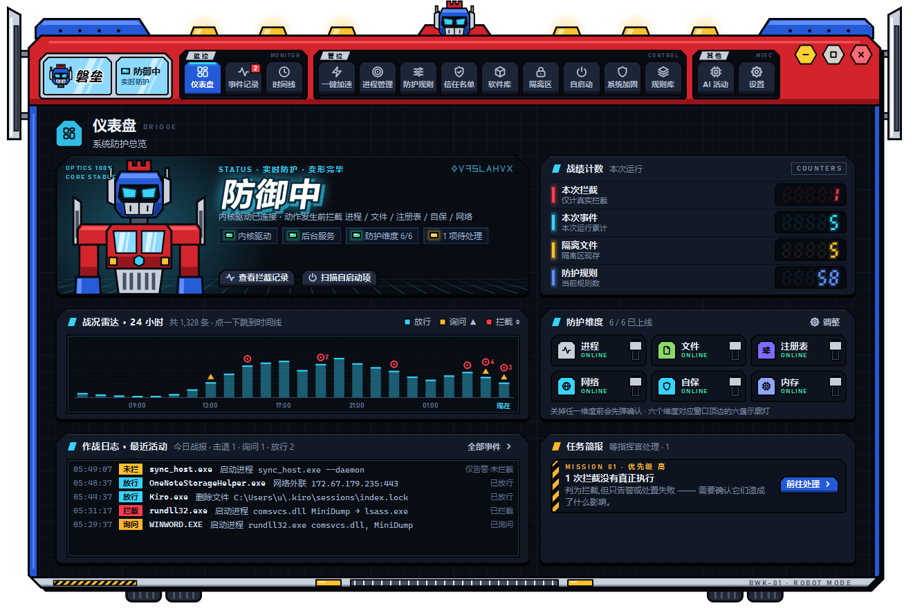
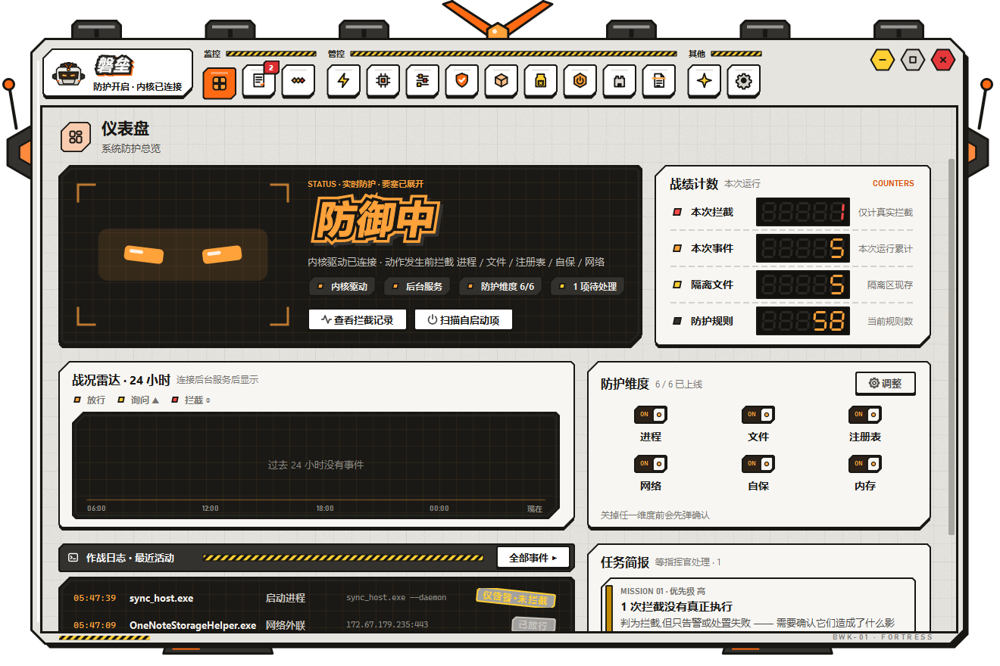
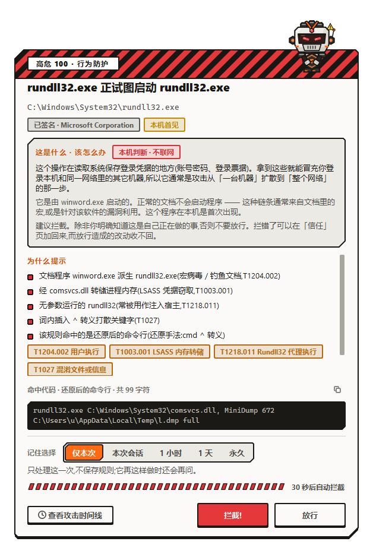
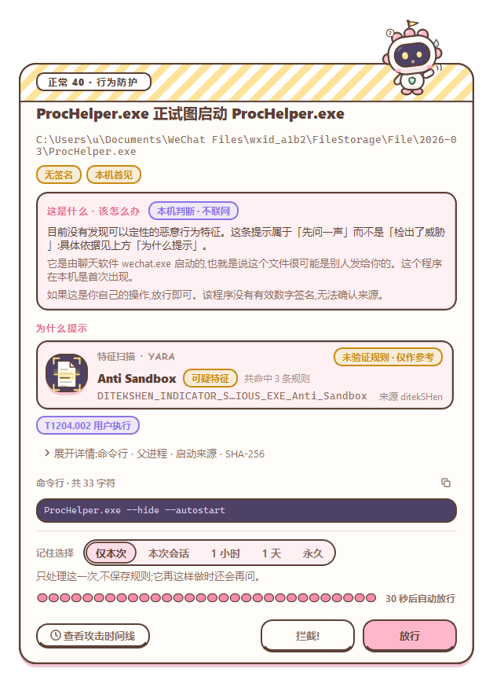
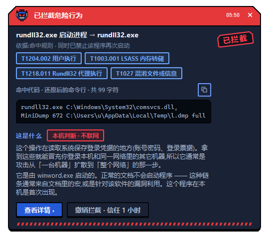
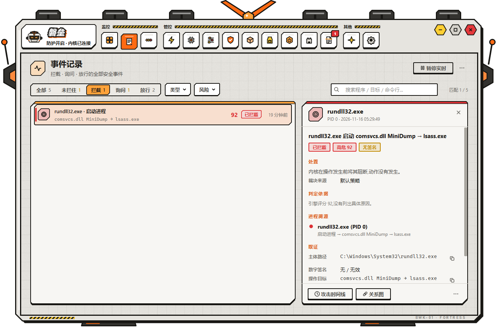
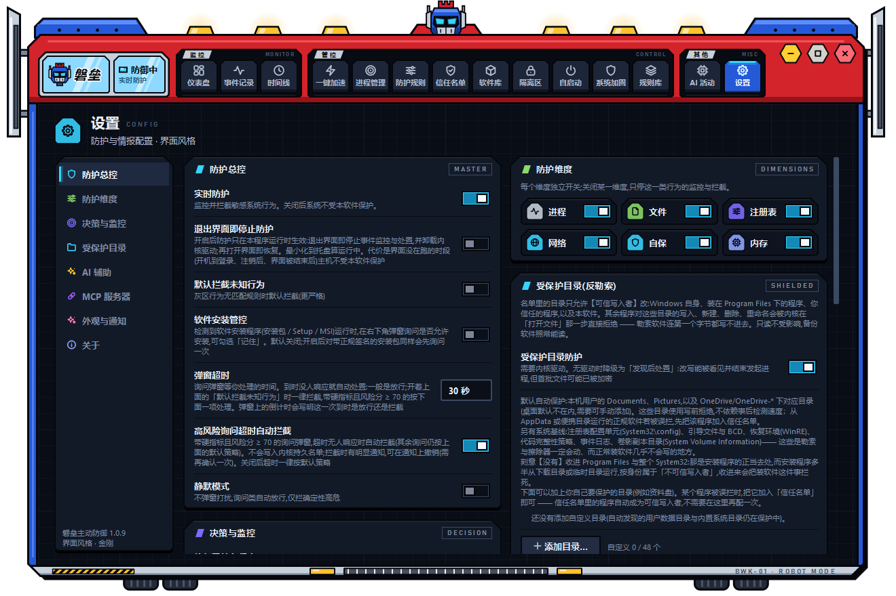

# 磐垒主动防御（Bulwark）

Bulwark 是一个面向 Windows 的主机行为防护项目。内核驱动和后台服务采集进程、文件、注册表、网络和脚本行为，按本地规则与行为分析给出放行、询问或拦截，并做收容、隔离和清理；桌面界面负责状态展示、询问弹窗和配置。当前版本 `1.0.9`，代码使用 C++20、Qt 6 和 Windows Driver Kit。

> **项目状态：开发中，不建议部署到生产环境。** 内核驱动以测试签名方式加载，需要关闭 Secure Boot 和内存完整性（HVCI）；进程处置、隔离和系统加固会改动系统状态。驱动相关功能只应在带快照的测试虚拟机中验证。
>
> 仓库没有 `LICENSE` 文件。公开可见源码不等于已经授予复制、修改或再分发的权利。

## 界面预览

> 下面的截图由仓库里的离屏预览工具（`bulwark_prompt_preview`，CMake 选项 `BULWARK_BUILD_UI_PREVIEW`）用内置示例数据渲染，用来展示界面长相，不是真实主机上的检测记录。

界面有「机甲」「卡哇伊」「金刚」三套风格，下面是同一个仪表盘在三套风格下的样子。

**金刚**



| 机甲 | 卡哇伊 |
|---|---|
|  |  |

**询问弹窗与拦截通知**：弹窗给出风险分、签名、提示原因、ATT&CK 技术编号和还原后的命令行，倒计时结束按策略自动处理；拦截后在桌面角落弹出通知，可以撤销。

| 高危询问弹窗（机甲） | YARA 命中询问（卡哇伊） | 拦截通知（金刚） |
|---|---|---|
|  |  |  |

**事件详情与设置**

| 事件记录与详情抽屉（机甲） | 防护总控与受保护目录（金刚） |
|---|---|
|  |  |

在「设置 → 外观与通知」里切换三套风格：


## 组成

| 组件 | 产物 | 职责 |
|---|---|---|
| 内核驱动 | `Bulwark.sys` | 文件系统 Minifilter、进程/线程/映像回调、注册表回调、对象回调和 WFP 出站过滤；在内核里做前置拦截并上报遥测 |
| 后台服务 | `bulwark_service.exe`（SYSTEM 服务 `BulwarkService`） | 事件汇总与富化、规则裁决、处置、存储、IPC、AMSI 服务端、YARA 扫描调度和各类后台监视器 |
| 桌面界面 | `bulwark_ui.exe` | 防护状态、事件、询问与通知、规则/信任/隔离管理、系统加固、YARA 规则库、AI 解读和设置；启动时请求管理员权限 |
| AMSI Provider | `BulwarkAmsi.dll` / `BulwarkAmsi32.dll` | 脚本执行前把内容交给服务同步判定，命中时拒绝执行；32 位版本供 32 位脚本宿主和 32 位 Office 使用 |
| YARA 辅助程序 | `bulwark_yarac.exe`（静态链接 YARA-X） | 由服务以受限子进程调起：编译 YARA Forge 规则包，扫描进程启动时的程序文件 |

驱动与服务通过 Filter Manager 通信端口交互，握手时核对协议版本（当前为 13）和能力位，不匹配时服务按无驱动处理。服务与界面、AMSI Provider 通过本地命名管道交互；控制管道只接受已提升的管理员进程、交互会话、且程序位于安装目录的客户端。

事件链：

```text
驱动回调 / ETW / 用户态监视器 / AMSI
                │
                ▼
      EventSourceCoordinator
                │
                ▼
  Worker 富化（路径、签名、哈希、父子链）
                │
                ▼
  RuleEngine + 专项分析器 + 时序检测 + YARA 结论
                │
       Allow / Ask / Block
                │
                ▼
内核前拦、用户态收容/结束、隔离与清理、审计、界面通知
```

AMSI 是独立的同步判定路径，不经过通用 `RuleEngine`。

## 运行模式

- **驱动模式**：设置里打开「内核驱动」（部署模板默认打开）后，服务连接 `Bulwark.sys`，可以在动作发生前拦截。驱动开机随系统加载。
- **用户态模式**：驱动未安装、无法加载或连接失败时，服务自动降级为 ETW 与用户态监视器观测，用冻结并结束进程、独占句柄阻止执行和用户态 WFP 过滤做补偿，并在后台持续重试连接驱动。
- **待机**：关闭主窗口只是收进托盘，防护继续。把防护设为「随界面」后，界面退出约 8 秒服务进入待机：停止事件源、卸载驱动、暂停新的处置（已做的处置不撤销），打开界面即恢复。
- **防关停**：防护生效时服务拒绝 `sc stop` / `net stop`，驱动拒绝非强制卸载。维护、升级、卸载前先在界面里关闭实时防护或让服务进入待机。

## 功能

### 行为采集

- 进程创建与结束、远程线程、映像加载、文件写入/删除/改名、注册表写入与整棵导入/替换/挂载、网络外联与 DNS、自我保护事件，以及 AMSI 脚本送检。
- ETW 会话（DNS、内核网络/注册表/文件/映像/远程线程/审计 API）在任何模式下都是基础事件源，按进程限速并去重；驱动模式下再叠加驱动回调上报的事件。

### 内核前置拦截（驱动模式）

- **执行**：禁止执行名单、驱动内异步 SHA-256 的已知恶意哈希匹配、危险命令行硬拦（`CommandHardBlocks` 和内置基线，如删除全部卷影副本）、禁止加载。
- **文件与注册表**：受保护目录写入前拦截、文件硬拦名单、受保护键与硬拦键；阻止导出 `SAM` / `SECURITY` hive。
- **进程与凭据**：对象回调剥离针对本产品进程和受保护进程的终止、写内存、远程线程等危险权限（反注入），并剥离读取 `lsass.exe` 内存的权限（反凭据转储）。
- **网络**：WFP 出站过滤，按 IPv4 地址/端口黑名单拦截；被封禁的进程 IPv4/IPv6 出站一律拦截。
- **引导区**：拒绝用户态程序对固定磁盘卷头部（引导区域）的原始写入，可移动介质放行；服务未连接时同样生效。
- **窃密防护**：下列敏感数据只允许各自的程序打开，其他程序在打开文件时被驱动拒绝：
  - Chrome、Edge、Brave、Vivaldi、Opera、Opera GX、Yandex、360、QQ 浏览器和 Firefox 的用户数据；
  - Thunderbird / Betterbird 邮件配置、Telegram 会话；
  - Exodus、Electrum、Bitcoin 钱包；
  - FileZilla 站点文件。

  条目和全局读者可以在 `appsettings.json` 的 `SensitiveDataGuardEntries` / `SensitiveDataGuardReaders` 中增减。
- 部分硬拦名单写入驱动服务的 `Policy` 注册表分支，用户态服务不可用时仍然生效。

### 检测与分析

- **规则**：内置规则按 ATT&CK 战术分为十组（执行、持久化、提权、防御规避、凭据访问、横向移动、命令与控制、影响、注入与驱动、系统完整性）。每条事件带结构化证据链和 ATT&CK 技术编号。
- **命令与脚本**：命令行分析与反混淆、脚本内容分析、命令爆发检测、进程链追踪和 DLL 侧载识别。
- **勒索**：诱饵文件、批量改写时序、文件内容判别（区分改写后仍是好文件还是已成乱码）；受保护目录默认包含系统基线和用户文件夹。
- **网络与时序**：下载器/释放器时序、C2 周期心跳、DGA 域名和行为基线。
- **无文件内存巡检**：私有可执行内存、内存里的完整 PE、`AmsiScanBuffer` / `EtwEventWrite` 被打补丁。
- **资源耗尽攻击**：短时间内反复触发同类动作的主体会被收容；位于可信目录的主体只告警。
- **签名**：校验 Authenticode 签名、证书吊销和过期后签名，可在 `AbusedSigner*` 里列出被滥用的签名者。默认信任签名健康的主体，不弹询问；带硬恶意指标、有侧载嫌疑或加载无签名模块的除外。
- **YARA**：进程启动时扫描主程序文件（微软签名的系统文件跳过），结论按 SHA-256 缓存，不阻塞事件处理。命中 `YaraRules.MaliciousRules` 列出的规则判为恶意，按高危事件进入处置流程（防护暂停期间只记下哈希，恢复后补处置）；其余命中只作可疑信号参与裁决。
- **引导区巡检**：服务保存每块物理磁盘前 64 KB 的基线并定期比对。发现引导扇区被擦除、MBR 引导代码被改或分区表变化时告警，不写回磁盘。
- **离线解读**：在本地把证据整理成可读的威胁解释卡片，不需要联网。

### 裁决与处置

- **动作**：放行（Allow）、询问（Ask）、拦截（Block）。
- **询问超时**：询问弹窗默认等 30 秒。开启「默认拦截」时超时一律拦截；否则只拦截带威胁指标且风险分不低于 70 的事件，其余放行。
- **静默模式**：不弹询问。勒索或高风险脚本达到止损阈值、有两类以上硬证据的高风险事件、命中高风险显式规则的事件自动拦截，其余放行并留痕。
- **软件安装管控**（默认关闭）：开启后，安装程序即使签名可信也要先询问。
- **用户规则**：可设为永久、仅本次会话或带到期时间。确认恶意的进程写出的关联文件会生成带期限的「释放物污点」规则。
- **处置结果**：与裁决分开记录。界面区分内核前拦、进程已结束、已收容但仍在运行、禁止再次执行、仅告警和处置失败。
- **隔离区**：文件复制进隔离区、且原文件删除成功才算隔离完成，可以还原。可选「拦截即隔离」（默认关闭）。
- **清理**：清理恶意进程树的落地文件，以及指向恶意文件的服务、自启动项、映像劫持和计划任务，并生成处置报告。确认恶意的文件可以加跨重启的「拒绝执行」ACE。

### 系统加固与劫持防护

- **基线体检**：列出可加固项，可一键应用或撤销。改动前记录原值。
- **lsass 保护**（可选）：把 `lsass.exe` 设为受保护进程（`RunAsPPL`）。需要重启生效，可能影响依赖读取 lsass 内存的软件。
- **劫持防护**（默认开启）：监视系统代理与 PAC、浏览器企业策略、网卡 DNS 和浏览器快捷方式。发现变化时弹出通知，可以在「系统加固」页还原或接受。

### 桌面界面

导航分三组，共 13 个页面：

- **监控**
  - 仪表盘：防护总览。
  - 事件记录：拦截、询问、放行的全部安全事件。
  - 事件时间线：按时间回溯，可以生成攻击关系图。
- **管控**
  - 一键加速：内存工作集回收、自启动项入口、找出占资源的程序。不清理磁盘或注册表。
  - 进程管理：在跑进程，以及服务和计划任务溯源。
  - 防护规则。
  - 信任名单：受信任的程序与目录。
  - 软件信任库：常用软件画像，用来降低误报。
  - 隔离区。
  - 自启动项：开机持久化审计。
  - 系统加固：基线体检、一键加固、劫持防护。
  - YARA 规则库：自动下载、编译，展示来源和跳过明细。
- **其他**
  - AI 活动窗口。
  - 设置：六个防护维度（进程、文件、注册表、自身、网络、内存）、内核驱动、询问策略、AI 与 MCP、界面风格和通知。

此外还有：带倒计时的询问弹窗、拦截通知与语音播报、处置报告、攻击时间线和关系图窗口、进程详情，以及桌面实时流量悬浮窗（ETW 采样 TCP/UDP、IPv4/IPv6 与 DNS）。常驻机器人「小垒」从任务栏升起，显示拦截数和待处理的询问，双击或右键菜单可进入「雷达模式（流量表）」。

界面有「机甲」「卡哇伊」「金刚」三套风格，可在「设置」或托盘菜单「界面风格」里切换。界面动画跟随 Windows「显示动画」设置，也可以用环境变量 `BULWARK_UI_MOTION=0` 强制关闭。

## 联网与数据边界

本地规则、驱动拦截和大部分分析不需要联网，也不需要账号或 API Key。下列功能会联网：

| 功能 | 默认 | 说明 |
|---|---|---|
| YARA 规则库更新 | 开 | 服务启动约 90 秒后、之后每 24 小时查询 GitHub 上 [YARA Forge](https://github.com/YARAHQ/yara-forge) 的最新发布。有新版本才下载规则包（默认 `core`），按发布页给出的 SHA-256 摘要校验（发布页没给摘要时会在结果里注明未校验），在受限子进程中编译。请求不带本机数据，扫描本身不联网。安装包内置一份预编译规则，没联网也能扫。`YaraRules.Enabled=false` 时完全不联网；自动更新也可以在「YARA 规则库」页关闭。 |
| 证书吊销检查 | 开 | 校验签名时向证书签发方的 CRL/OCSP 地址查询（`OnlineCertRevocationCheck`）。 |
| ThreatFox 情报 | 配置 Auth-Key 后生效 | 定期拉取 abuse.ch ThreatFox 近几天的 IOC，生成到期自动失效的哈希、IPv4 规则，可选生成域名规则。开关打开且配置了 Auth-Key（`ThreatFoxFeed.AuthKey` 或环境变量 `BULWARK_ABUSECH_AUTHKEY`）才会联网。 |
| AI | 未配置不联网 | 配置 OpenAI 兼容端点后，界面用它解读事件和流量、生成规则建议；生成的规则只是建议，要由用户勾选才生效。放行和拦截只由本地引擎和用户决定，服务不会把事件交给模型裁决。发给模型的内容包括程序路径、命令行（最多 1500 字）、进程链和证据摘要，其中只掩码了用户名。有月度额度保护（默认开启），额度用尽后 AI 解读和生成规则暂停，实时防护不受影响。 |
| MCP | 未配置不联网 | AI 对话时可以调用用户配置的 MCP 工具（stdio 或 Streamable HTTP），每次调用都要确认。 |

AI API Key 由服务用 DPAPI 加密后存入 `%ProgramData%\Bulwark\settings.json`，也可以用环境变量 `BULWARK_AI_APIKEY` 提供。MCP 配置用 DPAPI 加密后存在当前 Windows 用户的设置里。AI 接口和远程 MCP 端点只接受 HTTPS，本机回环地址可以用 HTTP。

## 配置与数据位置

- **`appsettings.json`**：与 `bulwark_service.exe` 同目录，是部署期配置，包括事件源和驱动开关初值、各类硬拦名单、窃密防护条目，以及 YARA、ThreatFox、ETW 参数。仓库里的模板是 `cpp\service\appsettings.json`。
- **`%ProgramData%\Bulwark\`**：安装器把它设为只有 SYSTEM 和管理员可以访问。其中：
  - `settings.json`：界面可改的运行时设置；
  - `quarantine\`：隔离区；
  - `history\`：事件历史；
  - `yara\`：规则库；
  - `bootguard\`：引导区基线；
  - `hardening-state.json`、`hijack-state.json`：加固与劫持防护状态；
  - `service.log`：服务日志。

  打开 `ExportEcsAlerts`（默认关闭）后，告警还会按 ECS 格式写入 `alerts\alerts-*.jsonl`，供 SIEM 采集。

## 已知限制

- 驱动遥测使用有界队列和零等待发送。队列满、服务未连接或发送失败时会丢事件，驱动对这三种情况分别计数。
- 「拦截」的效果取决于事件源。只有驱动路径能在动作发生前阻止；ETW 和用户态监视器只能事后收容、结束或清理。映像加载和远程线程回调本身也只能通知、不能拒绝。
- AMSI Provider 在服务不可用、超时或出错时放行（fail-open）。
- 驱动的 IP 黑名单只支持 IPv4；IPv6 只用于限制被封禁的进程。
- YARA 判恶意只认 `YaraRules.MaliciousRules` 里列出的规则，模板中为空，没在干净样本上验证过的规则只作弱信号。扫描结论只缓存在内存里，服务重启后会重扫；默认不扫超过 64 MB 的文件。
- 防关停挡得住脚本和普通管理员操作，挡不住已经拿到内核执行权的攻击者。待机时驱动已卸载，防注入和防卸载都不生效。
- 窃密防护按程序所在目录认定读者，而按用户安装的程序目录本身用户可写。借浏览器自己读数据（远程调试端口、注入浏览器进程）、复制已打开的文件句柄、管理员直接读卷，都不在覆盖范围内。备份、密码导入一类工具要读这些数据时，需要先把它们加为读者。
- 引导区巡检只告警不修复。分区表变化也可能来自正常的分区操作，需要人工判断。
- 勒索防护以检测、阻断和收容为主，不备份文件。
- 系统加固、跨重启的拒绝执行 ACE、隔离和清理会修改持久状态，测试前先做可恢复的快照。
- 驱动只有测试签名，正式发布需要走微软的驱动签名流程。
- 没有持续集成流水线。驱动的主机单元测试只覆盖 `MatchCore.c` 的纯匹配逻辑；回调、锁、IRQL、WFP 生命周期和卸载流程要在虚拟机里验证。

## 构建

要求：

- Windows 10/11 x64
- Visual Studio 2022 C++ 工具链，CMake 3.21 及以上
- Qt 6.8 MSVC 2022 x64（脚本默认路径 `C:\Qt\6.8.3\msvc2022_64`）
- 构建驱动另需 Windows Driver Kit（可用根目录的 `安装WDK-驱动工具包.bat` 安装）
- 打安装包用的 NSIS 已经放在 `installer\tools\nsis`

YARA 辅助程序静态链接 YARA-X 官方发布的 Windows C 接口包，这个包不进版本库。首次配置前执行一次，脚本会校验固定的 SHA-256：

```powershell
.\cpp\scripts\fetch-yara-x.ps1
```

没有这个包时 CMake 会跳过 `bulwark_yarac`，其余组件照常构建。

配置、构建并运行测试：

```powershell
cmake -G "Visual Studio 17 2022" -A x64 -S cpp -B cpp\build `
  -DCMAKE_PREFIX_PATH="C:/Qt/6.8.3/msvc2022_64"
cmake --build cpp\build --config Release --parallel
ctest --test-dir cpp\build -C Release --output-on-failure
```

测试包括裁决快照语料（`verdict_snapshot`）、内置规则集校验（`builtin_ruleset_ids`）、服务回归自测（`service_regression`）、IPC 路由自测（`ipc_routing_selftest`）、服务程序不含大模型调用的检查（`service_has_no_ai_verdict_client`），以及命令反混淆、勒索响应、威胁解读、YARA 更新调度等纯策略单元测试。

构建驱动（产物在 `build\driver\Release\Bulwark.sys`）：

```powershell
.\scripts\build-driver.ps1 -Configuration Release
```

生成完整的部署目录 `cpp\dist`：

```powershell
.\cpp\scripts\package.ps1
```

`package.ps1` 做这些事：

- 清空并重建构建目录和输出目录，放入服务、界面、AMSI、YARA 辅助程序、驱动和 Qt 运行库（windeployqt）；
- 自动获取 YARA-X；
- 用 `fetch-yara-forge.ps1` 下载固定版本的规则包，预编译成内置规则。

不要用它覆盖正在运行、或带真实配置的目录。验证时可以用 `-OutputDir` 指向别处。

构建安装器：

```powershell
.\installer\build-installer.ps1                       # 正式：用本机证书签名，并核对 ReleaseTrust.h 固定的证书
.\installer\build-installer.ps1 -UnsignedForTesting   # 只供测试的未签名安装包
```

安装器做这些事：

- 安装到 `Program Files\Bulwark`，并收紧 `%ProgramData%\Bulwark` 的权限；
- 注册服务、安装驱动、注册 64 位 AMSI Provider，并创建桌面和开始菜单快捷方式；
- 选项页可以开启测试签名模式（需要重启），并用本机个人证书自动签名驱动；两项都不选则只装用户态组件；
- 卸载时可以选择是否删除驱动、是否退出测试模式。

开发用脚本：

- `一键启动.bat`：调用 `cpp\scripts\dev-all.ps1`，构建并在本机安装服务、加载驱动。只应在带快照的测试虚拟机中使用。
- `一键启动-仅用户态.bat`：同上，但跳过驱动。
- `启用驱动.bat` / `停止驱动.bat` / `诊断驱动.bat`：加载、停止和诊断驱动，会自动请求管理员权限。
- `cpp\scripts\install-service.ps1` / `uninstall-service.ps1`：单独安装或卸载服务。
- `cpp\scripts\set-baseline-policy.ps1`：把受保护路径、硬拦名单、封禁 IP、已知恶意哈希等写入驱动策略。

## AMSI Provider

```powershell
cmake --build cpp\build --config Release --target BulwarkAmsi
# 32 位版本单独配置（SysWOW64 下的脚本宿主和 32 位 Office 只加载 32 位 Provider）
cmake -S cpp\amsi -B cpp\build_amsi_x86 -G "Visual Studio 17 2022" -A Win32
cmake --build cpp\build_amsi_x86 --config Release
.\cpp\scripts\register-amsi-provider.ps1
```

注册脚本的行为：

- 默认要求 DLL 有有效的 Authenticode 签名。只在隔离虚拟机里验证链路时，可以加 `-Force` 跳过这项检查。
- 按 DLL 架构写入对应的注册表视图。
- 不指定 `-DllPath` 时注册 64 位版本；找得到 `BulwarkAmsi32.dll` 就一并注册。

安装器只注册 64 位版本。

## 驱动测试

测试加载步骤：

1. 准备带快照的测试虚拟机，关闭 Secure Boot 和 HVCI，开启测试签名并重启。
2. 部署驱动：`.\scripts\deploy-driver-vm.ps1 -Configuration Release -SetServiceMode`。
3. 用服务日志、DebugView、CTest 和明确的允许/拒绝探针核对结果。

卸载顺序：先停用户态服务，再卸载 Minifilter，最后停止并删除驱动服务。

冒烟测试：

```powershell
cmake --build cpp\build --config Release --target driver_smoke_probe
.\scripts\driver-smoke.ps1 -InstallFromDist
```

前提是管理员 PowerShell、服务处于待机或已停止（驱动未加载）、本机有 D 盘。脚本的步骤：

1. 先在无驱动时确认各条绕过确实存在。
2. 加载驱动后逐条复测受保护目录、注册表整棵恢复、界面防注入和窃密防护等内核拦截。
3. 测完卸载驱动，并复原测试期间临时改动的受保护名单和窃密防护名单。

加载有问题的内核代码可能蓝屏。

正式发布的驱动可以用 `scripts\pack-driver-cab.ps1` 打成 CAB，提交微软做 attestation 签名。

## 目录结构

```text
Bulwark.Driver/   内核驱动源码、INF 和 WDK 工程
cpp/shared/       领域模型、IPC 契约、规则引擎与分析器
cpp/service/      SYSTEM 服务：事件源、裁决、处置、存储和监视器；appsettings.json 模板
cpp/ui/           Qt Widgets 界面、AI 与 MCP 客户端
cpp/amsi/         AMSI Provider（x64 随主工程构建，x86 单独配置）
cpp/yarac/        YARA 辅助程序（规则包解压、拆分、编译与扫描）
cpp/tests/        CTest：策略单元测试、裁决快照语料、驱动冒烟探针
cpp/scripts/      开发构建、打包、服务安装、AMSI 注册、驱动策略和 YARA-X / YARA Forge 获取脚本
cpp/third_party/  krabsetw（header-only ETW 库）、puff（zlib 附带的 deflate 解码器）；yara-x/ 由脚本下载，不进版本库
installer/        NSIS 安装器脚本、载荷组装和驱动安装/卸载脚本
scripts/          驱动构建、部署、签名、CAB 打包、发布组装、规则加工和维护脚本
docs/images/      README 用的界面截图（示例数据）
```

`cpp\dist` 是本机生成的部署目录，可能包含真实配置，已被 `.gitignore` 排除，不应该作为源码包分发。
